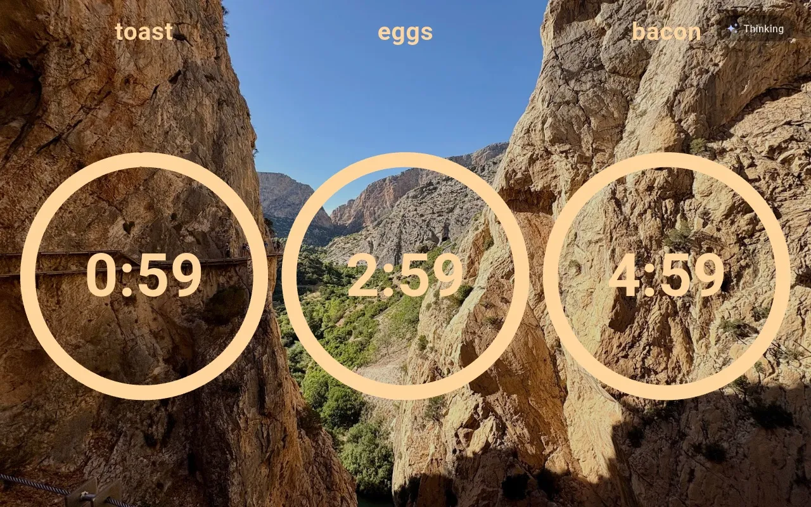
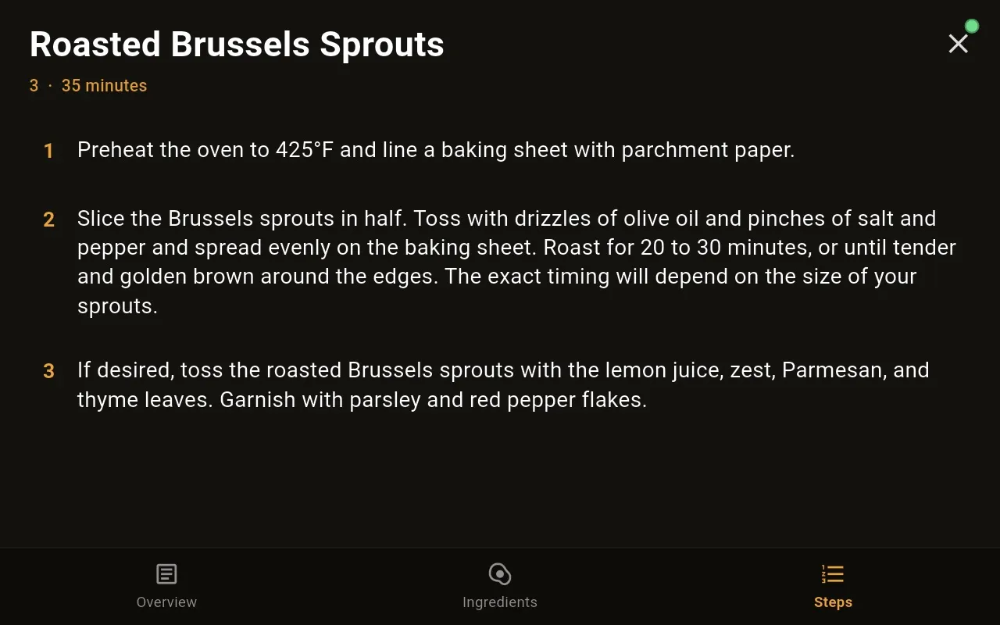
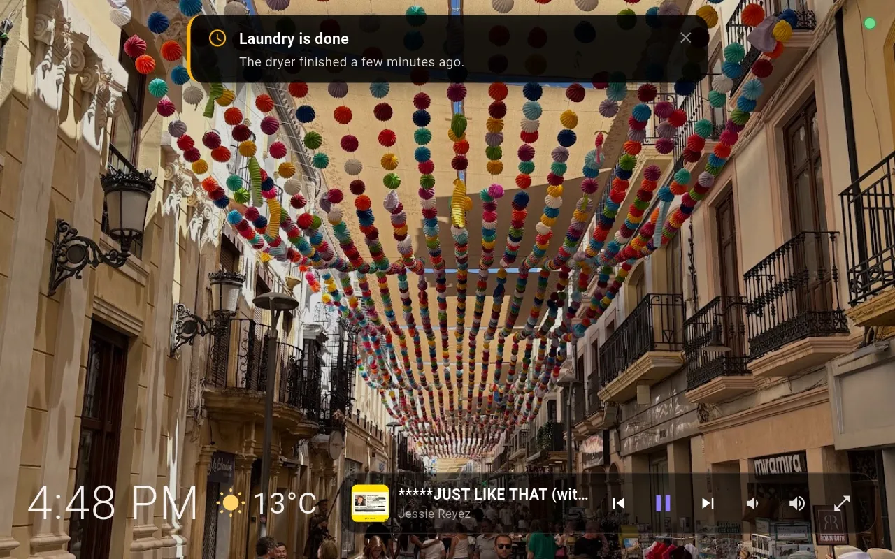
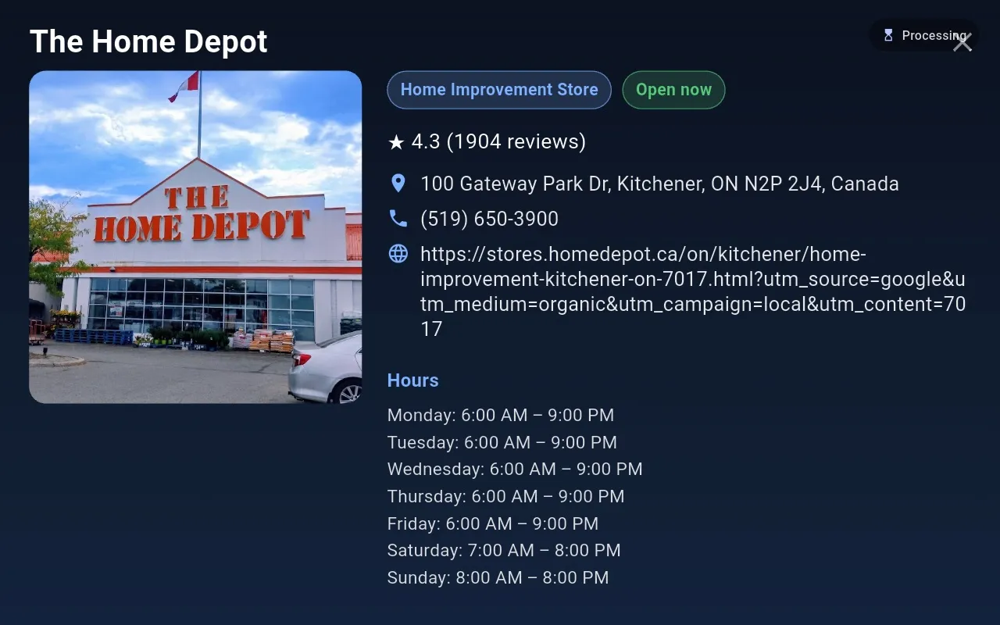
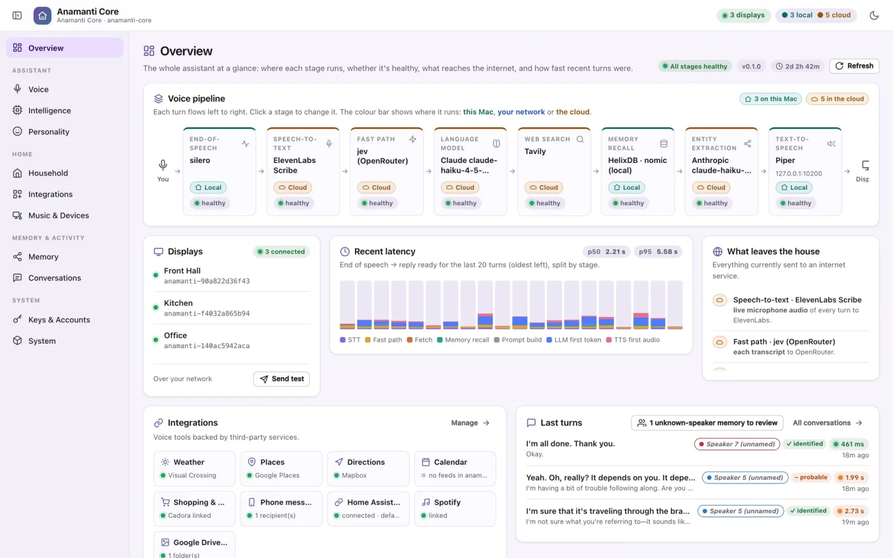

# Anamanti

### The soul of your home, given a voice.

**Private · Always on · Runs on hardware you own · Open source ([Apache 2.0](LICENSE))**

Say the wake word and just talk. Anamanti hears you in every room, thinks on a Mac
in your house, shows its answer on screen as it forms, and speaks it back a
sentence at a time.

From the Irish *anam an tí*, "the soul of the home" (pronounced **"AN-um un TEE"**).
Every stage can run on your Mac, elsewhere on your network, or in the cloud. You
choose, and it shows you exactly what leaves the house.

🌐 **[anamanti.com](https://www.anamanti.com/)** ·
[The Core](https://www.anamanti.com/core) ·
[The Display](https://www.anamanti.com/display) ·
[Hardware](https://www.anamanti.com/hardware) ·
[Echo Show install guide](https://www.anamanti.com/install) ·
[Technology](https://www.anamanti.com/technology)

<p align="center">
  
</p>

| **~0.5 s** | **0 model calls** | **24** | **1 Core** |
| :---: | :---: | :---: | :---: |
| end of speech → spoken reply for everyday requests (~2 s when the full model has to think) | for "turn off the kitchen lights", "show me the front door" or "remember that…" | voice tools: timers, weather, recipes, places, music, radio, camera, Home Assistant and more | serves every display in the house and replies on the screen that asked |

---

## A screen in every room, one brain in the house

Anamanti has three parts. They find each other on your network automatically, so
there are no IP addresses to type and no vendor account to create.

| | |
| --- | --- |
| **🧠 Anamanti Core** — *the brain, on a Mac* | Hears, thinks and speaks. End-of-speech detection, transcription, speaker ID, memory, the language model, tools and the voice, plus a console that shows every stage and where it runs. A Rust service (`anamanti-core/`). |
| **📺 Anamanti Display** — *the face, in each room* | Your photos, the clock and the weather when idle. When you talk: the live conversation, then recipes, timers, music, places and the front-door camera. Flutter UI on a Rust real-time audio engine (`anamanti-display/`). |
| **🎙️ Repurposed Echo Show 8** — *the ears* | A far-field mic array, a good speaker and an 8-inch screen, reflashed with LineageOS. Our favourite front end, but the Core works with any client that speaks its protocol. |

There's also **Anamanti Companion** (`anamanti-companion/`, Android + iOS, in
testing): status, now playing, every display's timers and memories on your phone
while you're on the home network.

## It doesn't just answer. It shows you.

<table>
  <tr>
    <td><br><sub><b>Timers.</b> Toast, eggs and bacon, at a glance.</sub></td>
    <td><br><sub><b>Recipe mode.</b> "Next step", "how much lemon?", hands-free.</sub></td>
  </tr>
  <tr>
    <td><br><sub><b>Notifications.</b> Pushed from the Core, no wake word.</sub></td>
    <td><br><sub><b>Place cards.</b> Hours, open now, rating and phone.</sub></td>
  </tr>
</table>

Every screenshot here comes from a running house with three displays.

## What sets it apart

**A real back-and-forth**
- **Follow-ups without the wake word.** The mic reopens after each reply (10 s if
  the answer ended in a question, 5 s otherwise) and stays open while you keep talking.
- **Barge in any time.** Say the wake word mid-answer: playback stops at once and the
  Core abandons the half-written reply (`anamanti-interrupt`).
- **Bilingual (in testing).** Turn on English + Brazilian Portuguese and each turn is
  answered in the language it was spoken in, with a matching Piper voice.

**It knows who's talking**
- **Voiceprints** (ECAPA-TDNN, on the Mac) tell household members apart on every turn.
- **Per-person memory.** "I like jazz" is remembered for you; "the wifi is FastNet"
  for the whole household; something said by an unknown voice is kept for review but
  never treated as true for anyone. "Who am I?" is answered from your voice.
- **A knowledge graph** of people, places and topics (embedded HelixDB) that you can
  browse, rename and delete.

**Fast where it counts**
- **Zero-model fast paths** for lights, the camera and memory commands: plain code,
  one direct call.
- **A System-1 classifier** answers timers, weather, time and "I'm done" without the
  big model, and defers to it below 0.85 confidence.
- **Streaming throughout.** Text appears as it's written and Piper speaks each sentence
  as soon as it's complete.

**Around the house**
- 🎵 **Music in every room** — "play some Radiohead" drives Spotify (librespot) in sync
  across Snapcast speakers; music ducks while the assistant talks. Internet radio
  plays through the same speakers. The display that asked goes full screen; other
  rooms show a compact bar.
- 🏠 **Home Assistant** — "turn off the lights" means *this* room. Matched against a
  cached device list, no model in the loop; if it isn't sure, it asks the model.
- 📹 **Front-door camera** — "who's at the door?" opens the Reolink NVR's live view on
  the display that asked. The video never leaves the house.
- 🍳 **Recipes, weather, places, directions, calendars, a shared shopping list and
  messages to family phones** — each a voice tool, offered to the model only when
  it's configured.
- 🎭 **Personalities** — "talk like a 1940s gangster". Changes only how a reply sounds,
  never what the assistant knows or does.
- 🌙 **A calm room** — the front camera is used only as a presence and light sensor:
  brighter when you walk up, dim when the room is empty or the lights go off. Nothing
  from the camera is stored or sent.

## You decide what leaves the house

The wake word is detected **on the display**, so no audio leaves the room until you
call it. After that, each stage is your choice: Whisper on your Mac or a cloud
transcriber, Ollama or Claude, local embeddings or OpenAI.

The Core's admin console (`http://127.0.0.1:8730/`, loopback only) labels every
stage **On this Mac / Your network / Cloud** and lists exactly what is sent where.
Keys stay in owner-only files on the Mac and are never shown back. There's no vendor
account, no hard-coded server, and no always-open microphone to someone else's data
centre.

<p align="center">
  
</p>

---

## Echo Show 8: the best ears in the house are already in a drawer

Smart displays were built around one hard problem: hearing you from across a noisy
room while they play music. The first-generation **Echo Show 8** solves it with a
4-mic far-field array, a good speaker and an 8-inch screen, and it's cheap
secondhand. Anamanti repurposes it: reflash with LineageOS, add echo cancellation,
install Anamanti Display. No Amazon account, no Amazon cloud.

| Echo Show 8 (1st gen) as we run it | |
| --- | --- |
| Model / codename | C7H6N3, product code AEOCW, **`crown`** (2nd/3rd gen are **not** supported) |
| OS | LineageOS 18.1 (Android 11), unofficial community build |
| CPU target | **32-bit ARM (`armeabi-v7a`)** |
| Memory | ~1 GB, which is why the audio path is Rust (no GC pauses) |
| Screen | 8″, 1280×800, landscape |
| Microphones | 4-mic far-field array + DAC loopback, sample-aligned, 16 kHz |
| Echo cancellation | SpeexDSP audio-HAL shim, ~16 dB, reversible (**required**) |
| Camera | Presence and light only; nothing stored or sent |
| Updates | The app updates itself (signed, SHA-256-verified) |

### Why the loopback matters

The Show delivers a hardware loopback of its own speaker output in the same capture
stream as the mics. A small audio-driver shim
([`EchoShow8gen1-aec-shim`](https://github.com/Brutus-GTC6245/EchoShow8gen1-aec-shim),
`libamznaec_shim.so`) runs echo cancellation against it *before* any app hears the
mic, removing ~16 dB of the assistant's own voice while keeping yours. That's what
makes barge-in produce clean transcripts. On top of that, the display raises the
wake-word threshold while it's speaking (default 0.70 vs 0.50 idle) so it doesn't
wake itself.

### Turning an Echo Show into an Anamanti display

> ⚠️ This replaces Amazon's software entirely (Alexa and Fire OS are gone, with no
> documented way back), almost certainly voids the warranty, and a wrong wipe can
> brick the device. Follow the community threads where they differ from this summary.
> The full, sourced walkthrough is the **[install guide](https://www.anamanti.com/install)**.

1. **Unlock + TWRP** — on supported Fire OS (reported 6.5.7.1–6.5.7.4, keep Wi-Fi off
   so it can't update), run the `amonet-crown` bootrom/bootloader exploit over
   micro-USB. No case opening. It reboots into TWRP.
2. **LineageOS** — in TWRP wipe **only** System, Data and Cache, then install
   `lineage-18.1-*-UNOFFICIAL-crown.zip` (Google apps are not needed).
3. **ADB** — enable USB debugging, then optionally ADB over Wi-Fi:
   ```bash
   adb tcpip 5555 && adb connect <device-ip>:5555
   ```
4. **Echo cancellation** (required; needs root — see the shim's README first, a bad
   install can wedge the audio path):
   ```bash
   git clone https://github.com/Brutus-GTC6245/EchoShow8gen1-aec-shim
   cd EchoShow8gen1-aec-shim
   ./scripts/install.sh --so prebuilt/libamznaec_shim.so   # pushes shim, reboots
   adb logcat -d | grep amznaec                            # confirm it loaded
   ./scripts/uninstall.sh                                  # to undo
   ```
   Tune the shim's post-cancellation makeup gain with
   `anamanti-display/scripts/set-aec-gain.sh [GAIN_DB] [ADB_SERIAL]` (default 34 dB;
   lower toward 30 if close speech clips).
5. **Install Anamanti Display** — build the APK (below) and `adb install` it. It finds
   the Core via mDNS; no IP to enter. Grant "install unknown apps" once so it can
   update itself.

Credit for the unlock and LineageOS work belongs to the Echo Show community — amonet
by R0rt1z2 and k4y0z, the amazon-oss `crown` device tree, and the XDA threads linked
from the install guide. Anamanti isn't affiliated with Amazon; Echo Show is a
trademark of Amazon.

### Tuned per room

Each display has its own capture gain, idle and while-speaking wake-word sensitivity,
smoothing, and a live **Audio diagnostics** screen (mic level + wake-word score) so
you can tune a kitchen versus a front hall in seconds. It also keeps about a day of
wake-word scores on device (numbers only, no audio) so a missed wake word can be
diagnosed afterwards — see [`plans/wakeword-tuning-guide.md`](plans/wakeword-tuning-guide.md).
The display never decides when you've stopped talking; the Mac does, with a neural
VAD, so the memory-tight device isn't asked to do the hard part.

### Bring your own screen

The Echo Show isn't required. A client only has to capture audio, play audio and draw
what it's told: a tablet, a TV, a Raspberry Pi with a mic HAT, or your own build.

- **Discovery:** the Core advertises `_wyoming._tcp` over mDNS with TXT `role=core`
  and a stable `instance_id`, so clients can find — and pin — a specific Core.
- **Turns:** one socket per turn carries 16 kHz mono PCM up and transcript, reply text,
  screen frames and spoken audio back, as newline-delimited JSON Wyoming frames + raw PCM.
- **Push:** a second long-lived socket (`anamanti-hello role=notify`) lets the Core
  send notifications, weather, music and camera requests any time.
- Frame definitions live in one shared crate, [`anamanti-protocol/`](anamanti-protocol/).

```
→ audio-start     device_id, room
→ audio-chunk …   16 kHz mono PCM
← transcript      "is the pharmacy open?"
← anamanti-place  a card to draw full screen
← audio-chunk …   the spoken reply, sentence by sentence
← anamanti-listen wait_secs: 10   # reopen the mic
```

---

## Architecture

```
Echo Show 8 (LineageOS)                     Mac (Apple Silicon)
┌──────────────────────┐                    ┌───────────────────────────────┐
│ Flutter UI  (Dart)   │                    │ Anamanti Core (Rust, tokio)   │
│   ▲ FRB v2 streams   │                    │  • Silero VAD (end of speech) │
│ Rust engine          │── Wyoming/TCP ────►│  • STT: faster-whisper /      │
│  • capture (cpal)    │◄── transcript ─────│    whisper.cpp / ElevenLabs   │
│  • wake word (tract) │◄── reply text ─────│  • speaker ID (ECAPA-TDNN)    │
│  • Wyoming client    │◄── TTS audio ──────│  • fast paths → System-1 → LLM│
│  • playback (cpal)   │◄── push frames ────│  • HelixDB graph + SQLite     │
└──────────────────────┘                    │  • TTS: Piper (Wyoming)       │
   mDNS: _wyoming._tcp, TXT role=core       │  • console :8730 (loopback)   │
                                            └───────────────────────────────┘
```

| Layer | Technology |
| --- | --- |
| Core | Rust · `tokio` · `rig` agent framework |
| Display | Flutter + Rust via `flutter_rust_bridge` v2 |
| Wake word | openWakeWord ("Hey Jarvis") on `tract-onnx`, on device |
| On-Mac inference | onnxruntime · whisper.cpp (Metal) · candle |
| Memory | HelixDB (embedded graph + vector) · SQLite + FTS5 |
| Transport | Wyoming over TCP · mDNS discovery |
| Audio | `cpal` / AAudio on device · Snapcast in the house |
| Console | Static HTML + Tailwind, compiled into the binary |

Deeper reading: [`plans/architecture.md`](plans/architecture.md) (design),
[`plans/Plan.MD`](plans/Plan.MD) (phases and decisions),
[`agents.md`](agents.md) (contributor and AI-agent build guidance).

## Repository layout

```
anamanti-core/       Anamanti Core — the Mac brain (STT ↔ LLM + memory ↔ TTS, console)
anamanti-display/    Anamanti Display — Flutter UI (lib/) + Rust device engine (rust/)
anamanti-companion/  Anamanti Companion — Android + iOS phone app (Flutter + Rust)
anamanti-protocol/   Shared Wyoming/Anamanti frame definitions (Rust)
website-src/         Source for anamanti.com (built into website/)
plans/               Design and planning docs
```

---

## Building & configuring

### 1. The Core (Mac)

**Prerequisites:** an Apple Silicon Mac on the same LAN as your displays, a Rust
toolchain (pinned by `rust-toolchain.toml`), and — unless you use the in-process STT
engine — Python for the off-the-shelf Wyoming servers.

```bash
cd anamanti-core

# Models the default build needs (each script defaults to ./models)
scripts/fetch-vad-model.sh        # Silero VAD — required: a default boot fails loudly without it
scripts/fetch-embed-model.sh      # nomic-embed-text — local, offline memory embeddings
scripts/fetch-speaker-model.sh    # optional: ECAPA-TDNN voiceprints for speaker ID
scripts/fetch-whisper-models.sh   # optional: whisper.cpp models for stt.engine=whisper-rs
                                  #   (--multilingual for bilingual mode)

cp anamanti.example.json anamanti.json   # per-instance config; edit to taste
cargo run --release                      # or: cargo run --release -- --config <path>
```

**Speech services.** Piper (TTS) is an off-the-shelf Wyoming server the Core is a
client to; STT can be one too, or run inside the Core:

```bash
# Example only — run these however you like (venv, launchd, …)
python -m wyoming_faster_whisper --uri tcp://127.0.0.1:10300 --model base.en --data-dir ./whisper
python -m wyoming_piper         --uri tcp://127.0.0.1:10200 --voice en_US-lessac-medium --data-dir ./piper
```

Set `"stt": { "engine": "whisper-rs" }` to skip the Whisper server entirely
(whisper.cpp in-process), or `"elevenlabs"` for ElevenLabs Scribe in the cloud.

**`anamanti.json` essentials** (see
[`anamanti.example.json`](anamanti-core/anamanti.example.json) for every key):

| Key | What it controls |
| --- | --- |
| `bind_addr` / `config_addr` | Device-facing Wyoming port (`0.0.0.0:10700`) and the loopback console (`127.0.0.1:8730`) |
| `service_name` / `instance_id` | mDNS name and the stable id displays pin to |
| `stt`, `stt_addr`, `tts_addr`, `tts_voice` | Speech engines and endpoints |
| `llm.backend` | `ollama` (default, local), `anthropic`, `openai`, or `mock` (offline, no servers) |
| `vad.engine` | `silero` (default) or `energy` |
| `memory_backend`, `graphrag` | `helix` graph recall (default) or `sqlite` FTS; local vs OpenAI embeddings |
| `speaker` | Turn on voiceprints: `{ "enabled": true, "model_path": "models/voxceleb_ECAPA512.onnx" }` |
| `language`, `tts_voices`, `tts_addrs` | Bilingual mode (e.g. `["en", "pt-BR"]` + `pt_BR-faber-medium`); see [`plans/BilingualPlan.md`](plans/BilingualPlan.md) |
| `system1` | Fast classifier backend (`none`, local Laya-Decision, or hosted Jev via OpenRouter) |
| `home_assistant`, `camera`, `music`, `spotify`, `drive`, `weather`, `places`, `calendar`, … | Integrations |

**Keys and accounts.** Paste provider keys (Anthropic, OpenAI, ElevenLabs, …) on the
console's **Keys & Accounts** page; they apply without a restart and are stored 0600
in `anamanti_settings.json`. Env vars such as `ANTHROPIC_API_KEY` only *seed* a key on
first boot; a stored value always wins. Claude can authenticate with an API key or a
Claude subscription token (`claude setup-token`). Model pickers list current
Anthropic/OpenAI models live. Most options — STT engine, LLM and model, voices,
embeddings, personalities, integrations — can be changed from the console, live.

**Music.** House-wide audio (Snapcast + librespot + mpv, launchd units) has its own
runbook: [`anamanti-core/deploy/snapcast/`](anamanti-core/deploy/snapcast/README.md).
The Core only controls the players; music PCM never passes through it or the Echo Show.

**Many displays, many Cores.** Any number of displays can share one Core (replies go
to the display that asked; memory is one household pool, scoped per person). You can
also run a test Core beside production: give it a distinct `service_name`,
`bind_addr` and `config_addr`; its `instance_id` defaults to the git branch code.
Use `memory_backend: "sqlite"` if it shares production's memory (SQLite is safe across
processes; the embedded graph is not). On each display, **Settings → Anamanti Core**
picks one — strictly, so a pinned display stays offline rather than silently switching.

### 2. The Display (Echo Show / Android)

**Prerequisites:** Flutter SDK, Android SDK + NDK, `flutter_rust_bridge_codegen`, and
the 32-bit Android Rust target:

```bash
rustup target add armv7-linux-androideabi   # Echo Show 8 (crown) is armeabi-v7a
```

```bash
cd anamanti-display

# After changing any Rust API signature, regenerate the FRB bindings
flutter_rust_bridge_codegen generate

# Build — cargokit cross-compiles the Rust engine into the APK.
# A `distribution` flavor must be named: `selfUpdate` (normal) or `fdroid` (no updater).
flutter build apk --release --flavor selfUpdate --target-platform android-arm

adb install build/app/outputs/flutter-apk/app-selfUpdate-release.apk
# …or for live development:
flutter run --flavor selfUpdate -d <echo-show-device>
```

> **Toolchain pin:** AGP 8.7.3 / Kotlin 2.1.0 / Gradle 8.11.1 — the bundled cargokit
> Gradle plugin doesn't support Gradle 9 / AGP 9 yet.

On first launch the display discovers the Core over mDNS. On-device settings (six
screens sized for the 8″ display, applied instantly) cover the assistant, listening
and wake word, audio diagnostics, the photo source, household voices and memories,
and updates. Anything sensitive, such as keys, lives only in the Mac console.

**Releases and over-the-air updates.** The `selfUpdate` build fetches a signed APK +
`latest.json` from a Cloudflare R2 bucket, verifies its SHA-256 and installs via
`PackageInstaller`. Bump `version:` in `anamanti-display/pubspec.yaml` (the `+N` build
number must always increase), then:

```bash
R2_BUCKET=anamanti-dl UPDATE_BASE_URL=https://dl.example.com NOTES="Bug fixes" \
  anamanti-display/scripts/release-r2.sh
```

Point each device at your domain under **Settings → Device → Updates** (Advanced
mode). Signing-key setup and the GitHub Releases / Obtainium path are in
[`RELEASING.md`](RELEASING.md); design in [`plans/UpdaterPlan.md`](plans/UpdaterPlan.md).

### 3. Testing

```bash
cargo test --manifest-path anamanti-core/Cargo.toml
cargo clippy --manifest-path anamanti-core/Cargo.toml --all-targets -- -D warnings
(cd anamanti-display && flutter test)
```

---

## Status

**A working build, not a concept.** Anamanti runs every day in our own house across
three Echo Show displays: wake word, streaming STT, fast paths and System-1, the full
LLM with tools, graph memory, speaker ID, music, the camera, Home Assistant and
over-the-air updates. Some features — bilingual mode and the Companion phone app —
are built and still being tested before they roll out. See [`plans/TODO.md`](plans/TODO.md)
for what's next.

Want to run it at home? Everything you need to build it is in this repo. If you don't
want to download and tinker yourself, **[join the waitlist](https://www.anamanti.com/join)**
and we'll let you know when there's a ready-to-install version.

Security issues: see [`SECURITY.md`](SECURITY.md).

## License

Anamanti is licensed under the [Apache License, Version 2.0](LICENSE).

Third-party components keep their own licences: the vendored crates and packages
under `anamanti-display/rust/vendor/` and `anamanti-display/third_party/`, the
downloaded models (openWakeWord, Silero, nomic-embed-text, ECAPA-TDNN, Whisper,
Piper voices), and the separate EchoShow8gen1-aec-shim project.
